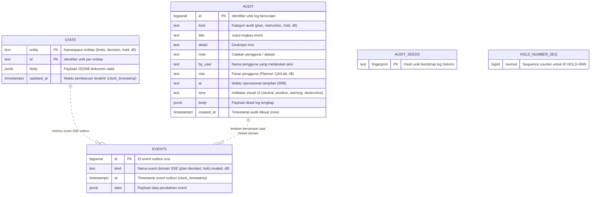
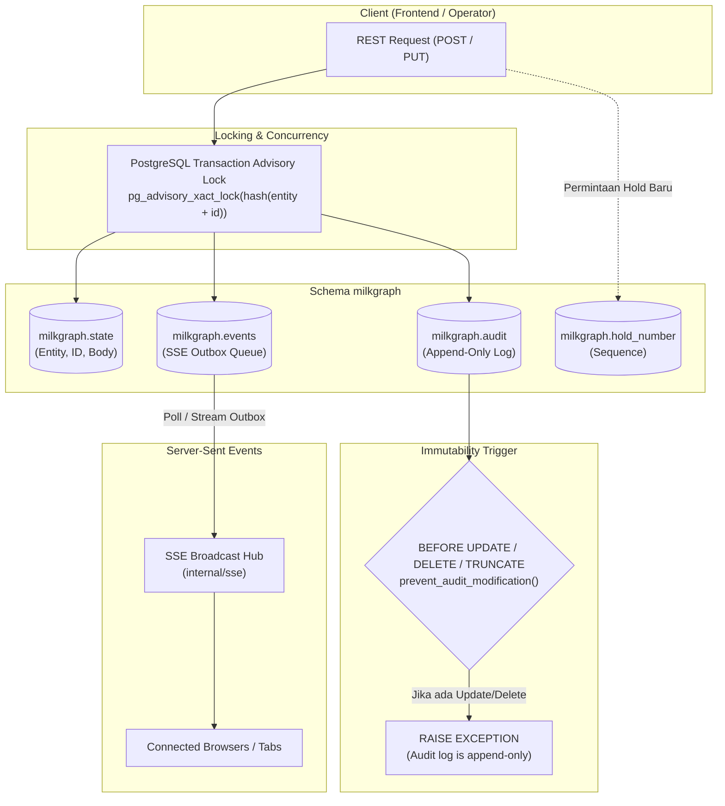

# Visualisasi Database MilkGraph

Dokumen ini mendeskripsikan arsitektur dan relasi penyimpanan PostgreSQL pada `Milkgraph-Back` (`schema: milkgraph`).

---

## 1. Entity-Relationship Diagram (PostgreSQL)

---

## 2. Diagram Alur Transaksi & State Machine

---

## 3. Spesifikasi Tabel & Objek Database

| Objek | Tipe | Keterangan & Invarian |
|---|---|---|
| `milkgraph.state` | Table | Key-value store fleksibel (`entity`, `id`) bertipe JSONB untuk persistensi dokumen dinamis (limits, decisions, holds, instructions ack). Diproteksi advisory lock per entitas saat mutasi. |
| `milkgraph.audit` | Table | Ledger audit log aktivitas seluruh pengguna. Dilindungi trigger `prevent_audit_modification()` sehingga bersifat mutlak **append-only** (tidak dapat di-`UPDATE`, `DELETE`, atau `TRUNCATE`). |
| `milkgraph.events` | Table | Outbox queue untuk event SSE real-time (`plan.decided`, `instruction.acked`, `limits.updated`, `hold.created`, `source.synced`). |
| `milkgraph.audit_seeds` | Table | Pencatat fingerprint bootstrap seed histori audit agar tidak terduplikasi saat restart backend. |
| `milkgraph.hold_number` | Sequence | Penomoran urut generator kode hold (`HOLD-001`, `HOLD-002`, dst). |
| `state_entity_updated` | B-tree Index | Indeks komposit `(entity, updated_at DESC, id)` untuk query list & sinkronisasi cepat. |
| `audit_kind_id` | B-tree Index | Indeks komposit `(kind, id DESC)` untuk filtering log riwayat persetujuan. |
